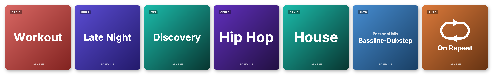
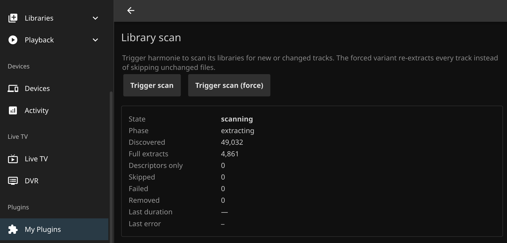

<p align="center">
  
</p>

<h1 align="center">Jellyfin Harmonie</h1>

<p align="center">
  <a href="https://github.com/mxschll/jellyfin-harmonie/actions/workflows/ci.yml">
    
  </a>
</p>

> [!NOTE]
> **Feedback wanted.** If anything in the install steps, settings, or playlist behaviour gets in your way, please open an issue. I want setup to be as painless as possible.

Jellyfin Harmonie generates playlists from your music library using audio similarity and listening data. Instant Mix returns tracks matched by the audio itself, and per-user playlists follow each listener's habits. The [harmonie](https://github.com/mxschll/harmonie) service does the audio analysis.

<p align="center">
  
</p>

**Upcoming**

* **Discovery Mix:** a per-user playlist of unplayed or long-unheard tracks that match recent listening.
* **Rewind:** a per-user summary of a listening period, like Spotify Wrapped.
* **Forgotten favorites:** tracks once played heavily and unheard for a long time.

## Install

The plugin requires [harmonie](https://github.com/mxschll/harmonie) 1.5.0 or newer. Install harmonie first, then the plugin.

### 1. Install harmonie

Run it with Docker, mounting the same music directories Jellyfin reads:

```bash
docker run -d --name harmonie --init --restart unless-stopped \
  -p 127.0.0.1:8842:8842 \
  -v ./harmonie-data:/data \
  -v /path/to/music:/music:ro \
  ghcr.io/mxschll/harmonie:latest
```

The first scan starts automatically. If Jellyfin runs on another machine or in its own container, publish on `0.0.0.0:8842` instead so it can reach harmonie. See the [harmonie README](https://github.com/mxschll/harmonie#install) for compose, pipx, and hardware requirements.

### 2. Install the plugin

In Jellyfin go to Dashboard > Catalog > Repositories (gear icon), and add this URL:

```
https://raw.githubusercontent.com/mxschll/jellyfin-harmonie/main/manifest.json
```

Open the Catalog tab, find Harmonie under Music, and click Install. **Restart Jellyfin**. Then open Dashboard > Plugins > Harmonie and enter your harmonie server URL. Harmonie listens on port `8842` by default, so on the same machine as Jellyfin the URL is `http://localhost:8842`. Save the form.

The settings page shows live harmonie scan progress:

<p align="center">
  
</p>

## Use it

Once harmonie finishes its first library scan, which can take several hours for a large library, Instant Mix works from the first tap. The per-user playlists build from listening data, so they appear and grow over the first days of use. Scheduled tasks under Dashboard > Scheduled Tasks rebuild them; run a task by hand or change its schedule there. Each playlist type is on by default and can be toggled and tuned in the plugin settings.

### Song Radio / Instant Mix

Tap "Instant Mix" on a track, album, artist, playlist, or music folder and the plugin returns tracks matched from their audio. Finamp's "Song Radio" uses the same matching. Works in every Jellyfin client.

### Personal Mix

A private mix per style each user listens to most. The number of playlists follows the available listening data.

### On Repeat

One playlist per user with the tracks they play on loop, longest unplayed first. A track qualifies after three plays in 45 days, and the playlist appears once five tracks qualify. Tracks stay after their plays age out of the window. Once the playlist holds 30 tracks, each new repeat replaces the one played longest ago.

### Unheard

One playlist per user with tracks they have never played, ranked by how close they sound to the tracks they play, favorite, and add to playlists most. At most three tracks per artist. Played tracks leave at the next refresh, and the playlist appears once five tracks qualify.

## Prefix playlists

For direct control, make a normal Jellyfin playlist with one of these prefixes. The plugin fills it and refreshes it after each edit.

| Prefix | Result |
| --- | --- |
| `[RADIO]` | Similar tracks based on the first five tracks. Earlier seeds have more influence. Reorder or remove tracks to change the seeds. |
| `[DRIFT]` | An evolving mix starting from the first track. Each group of results becomes the seed for the next. |
| `[MIX]` | A mix seeded from the user's recent plays, favorites, and playlist additions. The plugin replaces tracks you add by hand at the next refresh. |
| <code>[GENRE]&nbsp;X</code> | Tracks classified under a [Discogs genre](docs/discogs-styles.md#genres), such as `[GENRE] Hip Hop`. |
| <code>[STYLE]&nbsp;X</code> | Tracks classified under a [Discogs style](docs/discogs-styles.md#styles), such as `[STYLE] House`. |

See [the supported Discogs genres and styles](docs/discogs-styles.md).

Override settings with tokens inside the brackets:

| Token | Mode | What it does |
| --- | --- | --- |
| `n=N` | any | playlist length, 1 to 500 |
| `days=N` | mix | playback activity window, 1 to 365 |
| `top` or `top=N` | mix | seed from all-time favorites instead of recent plays |
| `drift` | mix | use drift mode for the expansion |
| `style_min=F` | style, genre | minimum classifier probability, 0.0 to 1.0. Defaults to 0.6 (configurable in plugin settings) |

Examples:

- `[RADIO n=40] Workout`
- `[DRIFT n=50] Long Mix`
- `[MIX top days=30] Heavy Rotation`
- `[MIX drift] Stretch Mix`
- `[GENRE] Electronic`
- `[STYLE n=200] House`
- `[STYLE style_min=0.5] Hard Techno`

Radio, Drift, Mix, Personal Mix, and Instant Mix each have a `0`–`1` variation setting. Higher values produce more varied results while keeping songs similar to the seeds; `0` keeps results deterministic.

## Listening data

The plugin records each listen in a local database: when it started and stopped, how much of the track was heard, pauses and seeks, whether it completed or was skipped early, and which client played it. It also tracks favorites and playlist memberships. [docs/database.md](docs/database.md) describes every table and column.

The plugin imports Jellyfin's play totals once at install and records listens from then on.

## How does this compare to AudioMuse-AI?

They aim at different things. If you know Plexamp's Sonic Analysis or Spotify's Song Radio and Daily Mixes, Harmonie is that for Jellyfin: radio from a seed track, per-user mixes built from listening history, forgotten songs brought back. [AudioMuse-AI](https://github.com/NeptuneHub/AudioMuse-AI) is a broader discovery toolbox with chat-based playlists and text and lyrics search, most of which need a client built against its API.

Harmonie lives in Jellyfin's own surfaces: the Instant Mix button, ordinary playlists, Scheduled Tasks, plugin settings.

- **Works in every client.** Playlists show up in the web UI, Finamp, Symfonium, downloads, and offline sync like any other playlist.
- **Playlists are the interface.** Rename a playlist to change its settings, reorder tracks to change the seeds. The plugin refreshes it in the background.
- **Personal, from listening.** Per-user playlists that rename and refill themselves as taste shifts.

Pick AudioMuse-AI for its breadth of discovery tools with a client that integrates them. Pick Harmonie for similarity-based playlists that live in Jellyfin and follow each user's listening.

## Compatibility

Jellyfin 10.10, 10.11 and 12. Each release ships one build per server line; the catalog picks the right one.

## License

GPL-3.0.
